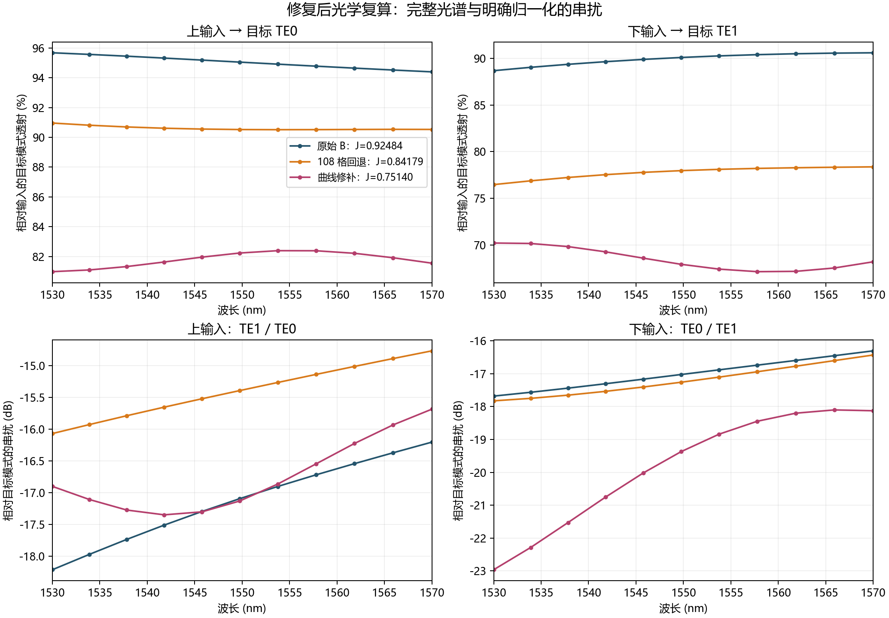

# B 结构修复复算：数据校核与下一步建议

日期：2026-10-12。本次只读取已完成的六次仿真数据，没有启动新的 FDTD 或远程任务。

**结论：两份修复版通过几何检查，但本次光学性能均未达到 J≥0.92。较少的材料变化也可能造成显著性能下降；目前只能否定这两个具体修复结果，不能否定所有后处理方案，更不能认定 B_strict 必然达到某个 J。**

## 1. 数据校核结果

核对了三份完整 `(2,2,11)` 光谱、六份单源光谱、`comparison.json`、三个结果 JSON、六份求解日志及输入 GDS/模板/清单/脚本指纹。光谱计算出的 J 与保存的 J 一致；三份结构的频率点一致，范围为 1530–1570 nm，采用频率等间隔采样。制造检查记录与实际 GDS 的 SHA256 对应，两个修复版均为 248 类公共检查零违规。

| 结构 | J | 相对 raw 的变化，百分点 | 上输入目标 TE0 | 下输入目标 TE1 | −10log10(J) 等效插损 | 公共 DRC 标记 |
|---|---:|---:|---:|---:|---:|---:|
| 原始 B | 0.92483999 | — | 95.041% | 89.927% | +0.339 dB | 103 |
| 108 格回退 | 0.84178956 | -8.305 | 90.616% | 77.742% | +0.748 dB | 0 |
| 曲线修补 | 0.75139535 | -17.344 | 81.795% | 68.484% | +1.241 dB | 0 |

raw 与历史记录的差值为 4.2521774e-07，支持原结果具有很好的重复性。回退版相对下降 8.980%，曲线修补版相对下降 18.754%；这与上表的“百分点变化”是两种不同口径。

带内平均目标仍为两个输入分别到目标输出模式的透射率平均，J 是优化目标值，不是谐振器品质因数 Q。插损取 `−10log10(T)`，这里三份结构的等效插损均为正值。先对两条通道分别转换成 dB 后再平均，数值会略不同：原始 B / 回退版 / 曲线版分别约为 +0.341 / +0.761 / +1.258 dB，不能和 `−10log10(J)` 混用。

## 2. 光学损失能确定到哪一步

回退版上输入目标效率下降 4.425 个百分点；下输入下降 12.185 个百分点。下输入是此次回退的更大损失来源。

曲线修补版两路目标效率分别下降 13.245 和 21.444 个百分点。它改变了孔洞和硅连接，说明“局部材料变化比例”无法替代光学敏感度评估。

| 结构 | 上输入到 TE1，相对输入 | 下输入到 TE0，相对输入 | 上输入交叉/目标比 | 下输入交叉/目标比 | 两个已提取前向模式功率之和，上/下输入 |
|---|---:|---:|---:|---:|---:|
| 原始 B | 1.854% | 1.799% | -17.099 dB | -16.988 dB | 96.894% / 91.727% |
| 108 格回退 | 2.623% | 1.489% | -15.384 dB | -17.179 dB | 93.238% / 79.231% |
| 曲线修补 | 1.741% | 0.751% | -16.720 dB | -19.598 dB | 83.536% / 69.235% |

串扰如果按相对目标通道定义，应使用 `10log10(T_cross/T_target)`；按输入归一化的 `10log10(T_cross)` 是另一个指标，应明确标注分母。`T_forward` 归一化于源注入功率，表示模式透射效率，并不直接等于输出模式纯度。[Ansys 模式展开结果定义](https://optics.ansys.com/hc/en-us/articles/360034902433-Using-and-understanding-Mode-Expansion-Monitors)

已提取的两种前向模式功率之和也随修复下降，因此问题并不是简单地把目标模式功率全部转移到了另一个已提取模式。但当前数据没有输入反射、完整输出模式集合或周围边界功率的闭合统计，不能把缺失功率全部指定为反射、辐射或某种高阶模式，也不能直接声称观测到器件内部“严重光场发散”或“谐振失谐”。这些属于需要额外数据检验的物理解释。

已有 HDF5 文件中可见输出截面的 E/H 数据；它们不是器件内部完整场分布，也没有独立完成反射/辐射分解。后续若需要研究损失机制，优先从已保存 FSP 提取输出总透射和展开系数，再按需要增加输入反射和器件场监视器。

曲线版 TE1 的 11 个采样值最小约为 67.13%；这些数据并没有出现“跌破 65%”。

## 3. 求解日志中的真实执行情况

六份日志均记录成功结束且满足 1e-5 自动停止条件。实际执行为 **5 次 Tesla P100 GPU，1 次 CPU**：raw 源 2 使用 `fdtd-engine-msmpi.exe`、14 个进程、每进程 1 线程；其余五次为 GPU 引擎，日志记录 real32。原报告“六次全 GPU”和“绝对相同的求解链路”需要修正。

raw 源 1 日志在成功完成、收集数据和输出耗时后还有 10054 连接错误。光谱完整且可复算，不能仅凭该错误否定已保存的数据；也不能把这条异常从执行记录中省略。下一轮应逐次记录实际 CPU/GPU 引擎，统一比较条件。

本次原结果重复差异远小于两份修复造成的 J 下降，足以支持“这两份修复未达 0.92”的结论。精确的硬件差异来源仍未独立分离验证。

求解器满足自动停止条件说明达到了当前停止标准；当前三份结构仍使用共同 20 nm 网格与常数折射率模型。这并不等同于已完成更细网格收敛、材料色散和实际制程验证。

## 4. 原附带报告应改正的结论

1. 将“品质因数 J”改为“光学优化目标 J”；插损改为正值，并区分对平均透射取 dB 与对通道 dB 再平均。
2. 将“TE1 纯度 77.74%”改为“相对输入的 TE1 透射效率 77.74%”。
3. 将“−8.3% / −17.3%”说明为 −8.305 / −17.344 个百分点；相对 raw 的下降约为 8.980% / 18.754%。
4. 保留“这两个具体修复结果性能较差”；撤回“任何事后修复都无法保住性能”的泛化判断。
5. 将“下通道阻抗匹配失效、谐振失谐、光场溢出”等明确标为尚未验证的机制假设。
6. 当前目录没有 B_strict 的已完成光学优化结果；J=0.88–0.90 是预测，不能当作既有结果或性能上限。

## 5. 下一步应从哪个合法起点出发

**优先使用原合法 B 初值，然后将单格与相邻两格动作一起纳入制造约束搜索。** 原合法初值的已有统一模型结果为 J=0.84981729，高于这份回退版约 0.803 个百分点。因此，单按已测 J 选择起点时，回退版没有优于原初值；可把它保留为第二个起点，用于检查不同搜索路径。

建议下一轮的具体顺序如下，这些是待执行实验，不是已取得的结果：

1. 在统一引擎下评估原合法 B 初值，核对原候选集合仍为 108 格、格外曲线固定、最终 GDS 两套制造检查均通过。
2. 运行单格 B_strict：提出一次整格 Si/SiO2 切换，先检查完整几何；通过后才运行两输入 FDTD；按同一 J 与原有接受阈值判优。逐步保存状态、检查记录、光谱和真实前向求解次数。
3. 单格完整一轮无改进时，围绕被冻结选区内的几何接缝或相邻格，提出两格共同改变。检查与评分对象是共同动作后的最终结构，不需要两个没有制造意义的中间单格状态分别合法。
4. 以相同预算比较原初值与回退版两个起点。它们的状态不同，既有单格光学增益不能跨状态复用或线性相加。
5. 如原 108 格内的单格/两格搜索仍达不到目标，再另建允许曲线边界变化的分支，比较受限法向位移或小范围修复后评分。该分支允许的设计自由度不同，应单独统计变化区域，不能继续称为原 108 格固定背景实验。

相邻两格动作可能绕过单格无法连接的合法状态，但是否能改善本器件性能必须运行后确认。制造约束既可以放入形状参数化，也可以进入优化目标；参数选择和初值会限制可搜索的空间。[Ansys 形状与制造约束文档](https://optics.ansys.com/hc/en-us/articles/360052044913-Optimizable-Geometry-Python-API)

J≥0.92 仍是需要验证的目标。在线 DRC 门禁只能保证被接受状态满足实际执行的规则，不能单独保证达到光学目标。这轮数据的价值是定量确认两份直接修复的代价，并帮助选择下一轮的合法起点。

## 6. 可复核文件

- 原数据：工程根目录的 `optical_recheck_results/comparison.json` 和三份 `spectra.npz`。
- 本次逐项校核：`recheck_audit.json`；图：`复算光谱与串扰校核.png` / `.svg`。
- 制造检查与修复参数：原 `analysis-repair-20261012` 文件夹。

原始计算结果与交接输入保持原样；本报告只补充校核与更正。
