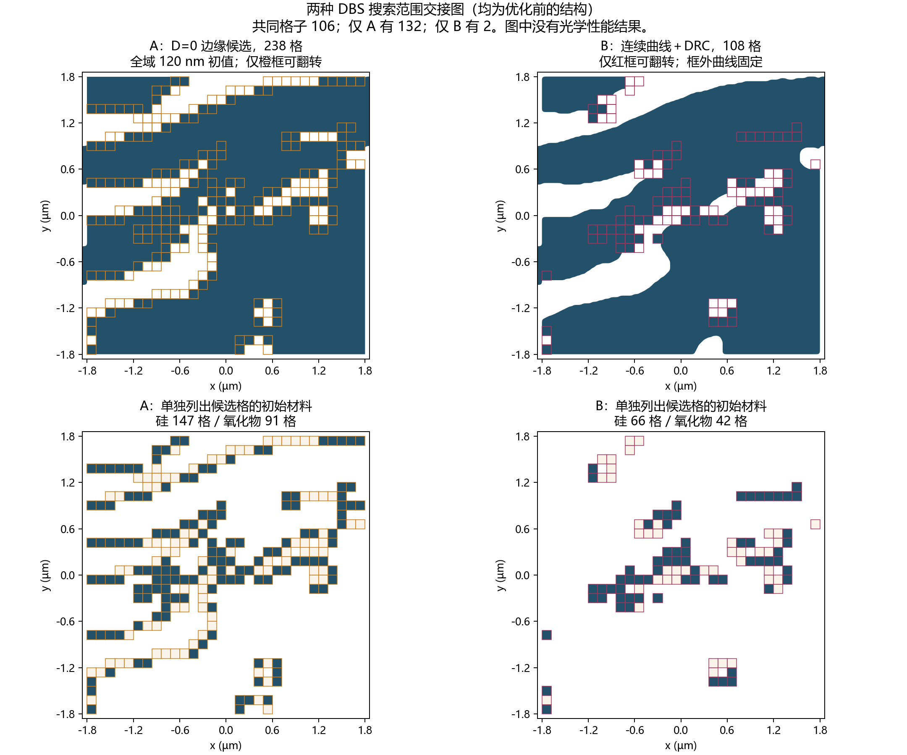

# 两种提取方案的 DBS 跨电脑操作指南

版本：2026-10-11。对象：接手本项目、在另一台电脑运行 Lumerical 的研究人员或编程助手。

**任务是从同一个已完成的两模 TO 结果出发，分别优化两种结构：A 为 D=0 边缘提取对应的 238 个候选格，B 为连续曲线经过 DRC 后局部替换得到的 108 个最终格。A 的非候选数字格固定；B 的格外连续曲线固定。** 两种方案都只能在各自候选格内切换整格 Si／SiO₂。

这份交接包已经完成输入整理、坐标统一、GDS 重建和实际几何检查。**尚未运行这两组的光学 DBS，也没有它们的插损、串扰、带宽或加速比结果。** `tools/common_device_template.lsf` 是供对方进行本机试运行的统一模型模板；它尚未在准备电脑上通过 Lumerical 执行。包内没有已接通并验证的完整 FDTD—DBS 程序，需要接手人按本文接口连接本机求解器。

## 1. 先确定要交付什么

### 1.1 两个主比较实验

使用 `config/experiment.json` 的约定，分别建立：

| 项目 | A_D0 | B_curve_DRC120 |
|---|---|---|
| 共同来源 | `inputs/common/2mode_final.npz` | 同左 |
| 结构表示 | 设计区全部为 120 nm 数字格 | 连续曲线＋局部 120 nm 数字格 |
| 本轮允许改变的格子 | 238 格 | 108 格 |
| 其余部分 | 662 个数字格固定 | 候选区域以外的曲线固定 |
| 初始候选格材料 | Si 147 格，SiO₂ 91 格 | Si 66 格，SiO₂ 42 格 |
| 主比较的光学目标 | 两个目标输出模式透射率的带内平均 | 同左 |
| 主比较的 DRC 策略 | `audit_only`，记录但不以 DRC 拒绝翻格 | 同左 |
| 默认扫描与停止 | 相同的逐列扫描；最多 4 轮；完整一轮无接受翻转则停止 | 同左 |

这样回答的是：**在同样光学 DBS 条件下，两种结构表示及各自选区能恢复多少性能、花费多少实际计算。** 两组的结构初值与表示不同，B 还经过几何修复，因此不能把差异全部归因于候选数量。

`audit_only` 是比较条件，不能据此保证 B 优化后仍符合制造规则。每轮和最终都应保存完整 DRC 结果，出现违规要照实报告。

### 1.2 B 方案需要保持制造要求时，另保存约束结果

使用 `config/B_strict.json`，从同一个 B 初值另开 `B_curve_DRC120_strict`：每次试探翻格必须通过实际 SP90 公共 DRC 和额外的 120 nm Si 线宽／间距检查，再参与光学判优。它仍只使用原来 108 个候选格。

**如果最终只提交一个可制造的 B 结构，应提交通过最终复检的 B_strict 结果。** `B_audit_only` 用于相同 DBS 条件下的比较；`B_strict` 用于保持当前制造约束。两者要单独命名和报告。

不要把 A 不加门禁、B 加门禁的结果描述成“只有候选数不同的公平对比”。如果要比较两种方案在相同制造门禁下的性能，需要另做 `A_strict`；A 的初始结构目前有违规，必须先在固定的 238 格内得到合法初值，单独记录修复成本。若不能修复，应报告失败原因，不能悄悄扩成 900 格搜索。

### 1.3 本文的 A 与论文原流程要分开命名

本次主比较的 A 是：**按原代码 D=0 规则取出 238 格，先构造全二值初值，再在这 238 格上做可多轮的 masked DBS。** 它不是论文原流程的完整逐步复现。

论文代码 `EG_ATDO()` 对非边缘格直接转换；尚未处理的边缘格保留原始模拟介电分布，逐格比较整格 Si／SiO₂，选定后再处理下一格。这是 EG_ATD 的逐步数字化过程。若接手人还要忠实复现此过程，另建 `A_paper_EGATD_D0`，按第 10 节执行，不能与本文 A 的二值初值 DBS 混为一条曲线。

## 2. 当前输入和已有证据

### 2.1 使用这一份 TO 检查点

`inputs/common/2mode_final.npz`：

- `eps`、`params` 都为 `(181,181)`；`x`、`y` 是包含两个端点的 181 点坐标；`z` 为 3 点。
- 设计区为 3.6 μm × 3.6 μm，原始采样间距 20 nm。
- `beta = 708.8018749850911`，投影离散度约 0.99136。
- 原 TO 使用 `filter_R = 240 nm`，`min_feature_size = 0`；保存目录中的 `f0239` 是取整造成的命名问题，不应当作真实滤波半径。
- SHA256：`8591BCF9612DAE081D454161C435289E02D7DEED6FAFF793B8509FC600DFF36D`。

不要用 `EGADO-2mode/TO/.../parameters_0.npz` 或五模目录下的中间结果替换这份数据。无需重新运行 TO。

`2mode_convergence.txt` 记录到第 248 次迭代，最后总 loss 约 0.0340265。它使用原 TO 的 ModeMatch 目标定义，不能直接换算成本文新 DBS 的平均透射率或插损。比较用的 TO 参考值应在统一模型下重新仿真。

### 2.2 B 的来源和为什么是 108 格

B 从原始 TO 灰度场提取连续曲线：σ=20 nm 高斯平滑、双三次插值、0.5 等值线；等值线提取网格 2.5 nm，轮廓弦采样约 10 nm，GDS 数据库精度 0.1 nm。

先对这条曲线做制造检查，再映射报错范围到 120 nm 方格。额外 120 nm 线宽／间距检查最初给出 **97 个**候选。一次按 Si 面积多数填格仍会产生接缝报错，随后进行了仅以几何为目标的两态修复与选区调整，最终得到 **108 格**：保留原候选中的 84 格、恢复原曲线 13 格、加入接缝区域 24 格。

当前 B 的文件为 `inputs/B_curve_DRC120/initial.gds`，它是此前 `target_120nm_optimized.gds` 的原样副本，SHA256：

`A5A35DFBEC69A76BF9E9BC883537E4F9E0BBF1CF8BEBFF2A7E482DA793B3CE65`

108/900=12% 的设计区被替换成整格材料；余下 **88% 区域保持输入曲线原状**。这里的参照是已经提取和平滑的曲线，不是未经处理的 20 nm 灰度图。实际材料变化面积约为曲线版本设计面积的 3.38%，也不能等同于边界保留率或光学性能保留率。

以下历史数字不用于本次主实验：74 格的早期栅格粗化、206 格的旧版 DRC 候选、97 格的初始选区，以及 79 格的 SP90 90 nm 分支。**本次 B 的可翻转集合固定为最终 108 格。**

### 2.3 打包后重新核验的初始 DRC

使用实际 `Wuyue_PDK_Klayout_Common_DRC_rule_V0.9.0.lydrc`，248 类规则：

| 结构 | 公共 DRC 标记总数 | 主要类别 | 额外 120 nm Si 线宽／间距 |
|---|---:|---|---|
| A 的中心采样二值初值 | 22 | WGF01=4、WGF02=12、WGF03=4、WGF04=2 | width=4，space=12 |
| B 的曲线＋108 格初值 | 0 | 无 | width=0，space=0 |

报告分别在 `evidence/A_initial_official_DRC/`、`evidence/B_portable_initial_official_DRC/`。它们对应当前包内初始 GDS 的 SHA，不能用于证明后续修改过的结构合规。

DRC 数量是规则产生的边对或多边形标记数，不是独立缺陷个数，也不是候选格数。密集曲线分段可能对同一个局部缺陷产生多个标记。

本次 0 违规只覆盖上述公共规则；额外 120 nm 检查只有 Si 线宽和间距，采用 85° 角度排除。它不等于一套完整的 120 nm 工艺规则，也没有验证全部手册条目或光学性能。

## 3. 交接包的文件怎么用

```text
DBS_交接包_2026-10-11/
  README_先读我.md
  接手任务说明.md
  两方案DBS_跨电脑操作指南.md
  manifest.json                      当前输入数量、SHA、核验摘要
  checksums.sha256                    打包文件完整性校验
  config/
    experiment.json                  A/B 相同光学 DBS 条件
    B_strict.json                    B 的制造约束版条件
    pdk-index.template.json           目标电脑修改路径后使用
    requirements-geometry.txt         离线几何工具依赖
  inputs/common/
    2mode_final.npz
    2mode_convergence.txt
  inputs/A_D0/
    conversion_matrix_legacy.npz      原 D=0 转换矩阵，行从上向下
    initial_state.npz                 统一坐标的候选掩码、二值初值、扫描顺序
    candidates.csv                   每个候选格坐标和旧代码索引
    initial.gds                      本文 A 的完整初始器件
    fixed_background.gds             移除候选格后的固定 Si 背景
  inputs/B_curve_DRC120/
    initial.gds                      经几何修复的完整 B 初值
    initial_state.npz
    candidates.csv
    fixed_background.gds             已精确扣除 108 个候选方格
    original_curve_sigma20.gds        修复前的原始曲线来源
    optimized_cells_original.npz      原始掩码留档
    final_cells_original.csv          原始格子编号留档
  tools/
    geometry_io.py                   校验、重建、最终几何检查、额外线宽间距检查
    run_drc.py                       来自本机版图 skill 的实际 DRC 启动器
    common_device_template.lsf        统一 FDTD 模板，待本机试运行
  evidence/                         对比图、完整 DRC 报告、几何核验记录
  code_reference/                   旧项目和几何流程代码快照，用于查阅
```

**移交整个目录或完整 ZIP。** `fixed_background.gds` 是模型构造用的中间文件，它删掉了候选格中的全部 Si；单独对它做 DRC 不能判断完整器件是否合规。

原始 PDK `.lydrc` 文件、PDK 安装库和 Lumerical 安装没有打包；证据目录保留检查时生成的 `runner.drc` 快照，其中含当时的规则正文和运行配置。跨电脑复检仍应使用目标电脑提供的同版本源宏及可用求解环境。所有新工具默认以自身所在交接包为根目录，不依赖原电脑的 G 盘路径。`code_reference` 的历史脚本、留档报告和生成的规则快照仍可能含原电脑路径；它们用于溯源，不是跨电脑直接运行的入口。

## 4. 目标电脑先做环境与输入核验

### 4.1 几何工具环境

下例在 Windows 的 PowerShell 7 中执行。修改根目录，使用目标电脑实际可用的 Python；本包的几何工具在 Python 3.12.4 环境验证。若目标电脑是 Linux，Python 工具和数据格式相同，改用本机 Python、KLayout 和 Lumerical 路径；下面的 PowerShell 写法仅用于 Windows。

```powershell
$handoffRoot = 'D:\work\DBS_交接包_2026-10-11'
Set-Location -LiteralPath $handoffRoot
py -3.12 -m venv .venv-geometry
$geometryPy = Join-Path $handoffRoot '.venv-geometry\Scripts\python.exe'
& $geometryPy -m pip install -r .\config\requirements-geometry.txt
& $geometryPy -X utf8 .\tools\geometry_io.py verify
```

`verify` 不会启动 FDTD。预期输出包含：A=238、A 候选 Si=147；B=108、B 候选 Si=66；交集=106、A 独有=132、B 独有=2；B 的额外 120 nm width/space 都为 0。它还校验文件 SHA、坐标、候选格单一材料、固定区域和加工层。

两种掩码不是严格包含关系。不要根据“B 数量少”自行将 B 解释为 A 的任意 108 格子集。

可选复核原 D=0 提取：

```powershell
& $geometryPy -X utf8 .\tools\geometry_io.py regenerate-d0
```

在包内记录的 scikit-image 0.23.2 下应得到 238 格，并与保存掩码逐元素相同。主实验直接使用已保存的掩码；若新版本 Canny 算出不同选区，应记录版本差异，不要用新掩码覆盖正式输入。

如果接手后需要改配置，先复制为 `experiment.local.json` 等新文件。保留原始输入与校验清单，避免运行中修改交接包的基准数据。

### 4.2 Lumerical 环境

先确认目标电脑上 FDTD 可以运行一个小测试模型，再确认 Python API 可导入。选择与该电脑 Lumerical 安装兼容的 Python。几何工具的依赖版本不自动代表 Lumerical 官方支持的 API 环境。

旧代码通过 `LUMERICAL_API` 定位包含 `lumapi.py` 的目录。例如：

```powershell
$env:LUMERICAL_API = 'C:\Program Files\ANSYS Inc\v251\Lumerical\api\python'
$fdtdPy = '目标电脑兼容的Python完整路径'
& $fdtdPy -c "import os,sys; sys.path.insert(0,os.environ['LUMERICAL_API']); import lumapi; print(lumapi.__file__)"
```

这一步只是导入 API，不是完成求解器验证。本文推荐的受限 DBS 本身不需要伴随梯度，也不必依赖 SPLayout 的优化器；可以用本机现有的 FDTD 调用方式实现第 8 节的循环。如果 FDTD 需要旧 Python，而几何工具使用新 Python，可以让光学循环通过独立 Python 进程调用几何导出/检查工具，不必把两套依赖强行放入同一个环境。

记录 Lumerical 版本、Python 和相关库版本、CPU/GPU、实际资源设置、可并行的任务数。原代码中的 `processor='CPU'` 字符串不能替代对实际计算资源的确认。

### 4.3 配置实际 DRC

复制模板为目标电脑的本地索引，只修改路径：

```powershell
Copy-Item -LiteralPath .\config\pdk-index.template.json -Destination .\config\pdk-index.local.json
$localDrcIndex = Get-Content -LiteralPath .\config\pdk-index.local.json -Raw | ConvertFrom-Json
$localDrcIndex.runtime.klayout_executable = 'C:\本机KLayout路径\klayout_app.exe'
$localDrcIndex.drc_profiles.common.path = 'D:\本机PDK路径\Wuyue_PDK_Klayout_Common_DRC_rule_V0.9.0.lydrc'
$localDrcIndex | ConvertTo-Json -Depth 12 | Set-Content -LiteralPath .\config\pdk-index.local.json -Encoding utf8
```

规则 SHA256 必须是：

`DB18D3B7CD4FAB7D7CA42B4D1A8572E8F072306EE90F29758F61F3CB799AE797`

启动器会核对规则 SHA 和 248 个类别。若本机拿到别的版本，需要单独记录为不同制造条件的实验，不能仅改预期 SHA 来宣称同规则复现。原电脑的来源是 SP90A V0.9.1 手册配套的 V0.9.0 KLayout 公共宏。

目标电脑先重跑 B 初始 GDS，使用一个新的空输出目录：

```powershell
& $geometryPy -X utf8 .\tools\run_drc.py --gds .\inputs\B_curve_DRC120\initial.gds --profile common --index .\config\pdk-index.local.json --output-dir .\results\preflight_B_DRC
& $geometryPy -X utf8 .\tools\geometry_io.py supplemental --gds .\inputs\B_curve_DRC120\initial.gds --threshold-nm 120
```

预期为公共 DRC 248 类、0 违规，额外 width=0、space=0。`run_drc.py` 返回 0 表示通过，1 表示确有违规，2 表示执行或输入失败。**没有产生报告、缺少类别或执行失败都不能算“0 违规”。** 需要保留 `result.json`、`result.lyrdb`、`run.log`，并核对报告记录的 GDS SHA 与当前文件一致。

## 5. 所有数组、坐标和材料的约定

这是接手时最容易错的地方。优先使用包内 `initial_state.npz` 和 `order_rc`，不要重新猜矩阵方向。

### 5.1 本包统一格式

`initial_state.npz` 包含：

| 字段 | 形状 | 含义 |
|---|---|---|
| `candidate_mask` | `(30,30)` 布尔 | True 表示本轮允许翻转的格子 |
| `silicon_state` | `(30,30)` 布尔 | True/1=Si，False/0=SiO₂ |
| `order_rc` | `(N,2)` 整数 | 按列从左到右、每列从上到下的 `(row,col)` 扫描序列 |

行号 `row=0` 对应最低的 y，随行号增大向 +y；列号 `col=0` 对应最低的 x，随列号增大向 +x。对于 B，**掩码外的 `silicon_state` 不是曲线的材料描述**；那里由 `fixed_background.gds` 定义，不能用此布尔数组把格外区域填成整格。

格子坐标，以 μm 表示：

```text
x_left   = -1.8 + 0.12 * col
x_right  = x_left + 0.12
y_bottom = -1.8 + 0.12 * row
y_top    = y_bottom + 0.12
x_center = -1.8 + 0.12 * (col + 0.5)
y_center = -1.8 + 0.12 * (row + 0.5)
```

在 FDTD 中长度使用 m，需要再乘 `1e-6`；不能把上面的 μm 数值直接传入求解器。GDS 的 `dbu=0.0001 μm=0.1 nm`。

### 5.2 与旧 EGADO 代码对接

旧代码的矩阵第 0 行位于最高的 y，材料定义也相反：**0=Si，1=etch/SiO₂**。旧像素索引为：

```python
legacy_n = (29 - row_y_up) * 30 + col_x_right
legacy_state = 0 if silicon_state[row_y_up, col_x_right] else 1
```

如果确实需要 A 的整个旧格式二值数组：

```python
legacy_top_down = (~np.flipud(silicon_state)).astype(np.uint8)
legacy_flat = legacy_top_down.ravel(order="C")
```

**这段整数组转换不能用于调用旧代码给 B 加载 900 个像素。** B 只能根据 `candidate_mask` 的 108 个位置调用翻格，其余 Si 形状是固定曲线。

`candidates.csv` 已提供 `legacy_n` 和 `scan_step_0_based`。图中或 CSV 的 `id` 是从上到下编号，用于标记位置；它不是默认逐列的执行次序。实际循环读取 `order_rc`。

旧代码中的 C/F 排列转换在正方形两模例子里容易掩盖方向问题；不要把同一写法直接推广到非正方形器件。

### 5.3 A 的掩码和初值如何产生

原转换对 `eps` 转置，移除最后一行和列得到 180×180，再上下翻转、取负号并归一化；Canny 后使用 **6×6 的 ANY 池化、stride=6、padding=0**。这就是本次 D=0。边缘格在旧转换矩阵中为 0.5。

本包的 A 掩码来自：

```python
legacy_candidate = (conversion_matrix > 0.49) & (conversion_matrix < 0.51)
candidate_mask = np.flipud(legacy_candidate)
```

为形成本文的全二值 DBS 初值，所有 120 nm 格按原代码的块中心采样规则取值并阈值化。6 点宽的块使用 `(start+stop-1)//2`，即相对索引 **2**，不是自行改成索引 3 或块平均。候选格也用此规则初始化；0.5 在这里是“待选择”标记，不能作为半硅材料进入二值 DBS。

原 D=0 非候选直接转换为 Si 562 格、SiO₂ 100 格；本文候选初值为 Si 147 格、SiO₂ 91 格，因此全域初值 Si=709、SiO₂=191。若改为面积多数或块均值初始化，必须另命名并对两组初始化差异做说明。

## 6. 如何在求解器里保留 B 的连续曲线

### 6.1 建议先使用“完整 GDS 导入”的可靠接口

对于任意当前状态 `s`，完整的 Si 区域定义为：

```text
Si(s) = 固定 Si 背景 ∪ 所有状态为 Si 的候选方格
```

`fixed_background.gds` 已从完整初始 Si 中扣除候选方格的整个面积。对 A，它留下固定的非候选数字格和公共端口；对 B，它留下候选区之外的连续曲线和公共端口。状态为 SiO₂ 的方格不添加 Si，由背景氧化物填充。

导出当前状态的完整 GDS：

```powershell
& $geometryPy -X utf8 .\tools\geometry_io.py export --scheme B --states .\results\B\current_state.npz --gds .\results\B\current_full.gds
```

如果省略 `--states`，导出该组初值。结果状态文件的最低要求是包含二值 `silicon_state`；建议同时保存原样 `candidate_mask`。工具会拒绝掩码变动和非候选数组状态的变动，并检查格外几何、候选格单一材料和加工层。运行产生的文件放进独立 `results` 目录，保留 `inputs` 原状。

初期每次用这份完整 GDS 构造 FDTD 结构，便于核对实际几何。接通后若重建模型耗时明显，再用第 6.3 节的对象更新方式提速。

### 6.2 GDS 导入要明确 layer/datatype

加工图层是：

- `13/1 WGF_COR`：实际 Si 轮廓，进入光学模型。
- `13/2 WGF_CLD`：刻蚀窗口；它不代表整片 Si。
- `251/16 DEV_AREA`：器件范围；它不代表 Si。

只导入 **`"13:1"`** 作为 Si，沿 z 挤出到 −110 nm 至 +110 nm。使用单纯数字 `13` 可能混入同层其他 datatype，尤其不能把窗口也填成 Si。`gdsimport` 支持用 `"layer:datatype"` 指定数据类型，并指定材料与 z 范围。[Ansys 官方 gdsimport 文档](https://optics.ansys.com/hc/en-us/articles/360034406974-gdsimport-Script-command)

本包 A/B 使用完全相同的设计区外 Si，取自已验证 B GDS 的区外部分。它包括曲线平滑后靠近设计区的端口接缝，远端输入/输出宽度保持 500/900 nm。此约定用于统一两组接口；A 是本文的公共端口对比版，不能据此声称原论文直波导接口的逐位复现。

统一模板会删除其原先创建的三条直波导，再导入完整 GDS 的 Si，避免重叠的旧对象覆盖真实接口。完整 GDS 的固定引线延伸到 x=±2.8 μm，超出本模板的 FDTD x 边界 ±2.3 μm。采用其他基础模型时同样要处理重复波导与旧 `design_eps` 对象。

首次导入后检查 z=0 的折射率截面：曲线轮廓、孔洞、候选格状态、输入上下次序、输出位置都应与 GDS 相符。GDS 支持特性与导入结果仍需本机核查；不要用 polygon 外边界填充替代带孔轮廓。[Ansys 官方 GDS 导入说明](https://optics.ansys.com/hc/en-us/articles/360034901933-Importing-and-exporting-GDSII-files)

### 6.3 后续可改为固定背景＋候选矩形对象

完成完整 GDS 路径的核验后，可以只导入固定背景，再为每个候选格创建 120 nm×120 nm×220 nm 矩形，按状态指定 `n_wg` 或 `n_bg`，仅更新该对象材料。两份源模型必须同步。

固定背景已经扣除整个候选区域，因此 Si 与 SiO₂ 切换不依赖“在旧 Si 上覆盖一层氧化物”来抵消材料。确认 Si 对象的优先级高于背景包层，矩形中心和跨度均精确。

用同一初始结构分别通过完整 GDS 路径和对象更新路径仿真一次，结果应在求解重复性范围内一致，再开始长时间优化。

以下改法会破坏 B 的定义：把所有曲线重采样为 20 nm 方块再导入；按布尔状态重建全部 900 格；只导入 108 个方格而遗漏固定曲线；根据当前 DRC 报错不断扩大选区但仍称为“108 格实验”。

## 7. 两组必须共用的光学模型与评分

### 7.1 几何和求解设置

详细数值见 `config/experiment.json`。主比较默认如下：

| 参数 | 数值/要求 |
|---|---|
| 设计区 | x、y 均为 [−1.8,+1.8] μm |
| Si 厚度 | 220 nm，z=[−110,+110] nm |
| 输入 | 上端 y=+0.65 μm，下端 y=−0.65 μm；宽 500 nm |
| 输出 | y=+1.35 μm，宽 900 nm；不是位于 y=0 |
| 输入模式 | 两个源都注入各自输入波导的 TE₀ |
| 目标输出 | 上端输入→TE₀，下端输入→TE₁；旧代码所选模式编号 [1,2] |
| 带宽 | 1530–1570 nm，11 个实际监测采样点 |
| 优化网格 | 设计区 dx/dy/dz=20/20/20 nm；输入源、输出监测处采用统一局部网格 |
| 初始求解设置 | mesh accuracy=3，最大时长 5000 fs，auto shutoff min=1e−5 |
| 边界 | z_min=Symmetric，其他边界=PML；两组一致 |
| 本包模板范围 | FDTD span=4.6×4.6×2.0 μm；源 x=−2.1 μm，输出监测 x=+2.1 μm |

**不要 A 使用 `base_EGA2D.lsf`、B 使用 `base_DBS.lsf` 后直接比较。** 当前代码快照中，TO 设计网格是 20/20/20 nm，EG_ATD 是 30/30/22 nm，旧 DBS 是 25/25/22 nm。本文统一模板以 TO 模板为基础并统一输出处网格，需要在本机导出的 `.fsp` 中核对实际设置。

若硬件或求解器要求改变边界或网格，两组和参考结构一起重建并重新仿真。不要单独为 B 改成全 PML，也不要把不同材料/网格的旧 TO 数值接到新的 DBS 曲线上。

### 7.2 材料统一并冻结

原模型使用自定义实折射率材料。本次主比较从 TO 检查点冻结为：

```text
Si:    eps = 12.085214794079695，n = 3.4763795526495227
SiO₂:  eps =  2.0851426458070788，n = 1.4440023011779028
```

A 和 B 均使用这两个常数材料，在相同 40 nm 带宽评分。这样避免不同电脑材料库版本或“Si 用 Palik 色散、模拟灰度却用固定 eps”的差异。之后若需要带色散的物理验证，两组初值和最终结果都用同一套色散材料重新评估，作为另一个模型条件单独报告。

### 7.3 透射必须按输出模式分解

每个结构分别运行两个输入源；一次只启用一个源。每次运行都读取输出 TE₀ 和 TE₁，整理为：

```text
T[source_index, output_mode_index, wavelength_index]
shape = [2, 2, 11]
```

目标透射是 `T[0,0,:]` 和 `T[1,1,:]`，串扰透射是 `T[0,1,:]` 和 `T[1,0,:]`。求解器模式编号通常从 1 开始，物理 TE 名称从 0 开始；首次必须看模式场和偏振，确认选中的 mode 1/2 实际是 TE₀/TE₁，不能只相信字符串标签。

采用模式展开监测器的 `T_forward`，而非普通 power monitor 的总 `T`，也不是未经功率归一化的展开系数平方。`T_forward` 表示到所选前向模式的归一化功率。[Ansys 官方模式展开解释](https://optics.ansys.com/hc/en-us/articles/360034902433-Using-and-understanding-Mode-Expansion-Monitors)

模板使用 `setexpansion("Output", "fom...")`，因此结果名是 `"expansion for Output"`。历史辅助脚本可能把展开条目命名为监测器名，此时结果名也不同。第一次先列出可用结果并确认键、频率轴和数组形状，再固定读取方式。

保存实际频率 `f`，计算 `lambda=299792458/f`，将波长排序后同时重排四条透射谱。11 点是求解器实际采样点，不能假定正好为等波长间距的 `1530,1534,...,1570` nm。两组使用相同的频率/波长数组，禁止一个使用中心波长而另一个使用带内平均。

本文的目标函数：

```text
J = [meanλ(T_top→TE0) + meanλ(T_bottom→TE1)] / 2
```

最大化 J。若沿用旧 loss，可以设 `L=2−mean(T_top→TE0)−mean(T_bottom→TE1)=2(1−J)`，最小化 L。本主实验不额外加入串扰惩罚；串扰必须作为输出指标记录。要加惩罚系数时，对两组同时修改并另存实验配置。

## 8. DBS 实际操作次序

### 8.1 开始完整搜索前的试运行

1. 完成第 4 节输入和 DRC 核验。
2. 导入 A 初值和 B 初值，各自检查折射率截面、材料、端口、源启用状态及输出模式。
3. 每个初值各运行两个输入源，共得到各自 2×2×11 的透射结果。
4. 至少对同一初值重复评估一次，估计 FoM 波动；将接受阈值设得高于求解波动并对两组一致。配置里的 `ΔJ=1e−4` 是待校准初值，不是已经测得的误差。
5. 任选一个候选格，构造 Si 与 SiO₂ 两种完整几何并回读核验；评估后恢复初始状态，确认结果与原初值一致。
6. 如使用对象更新的加速路径，完成它与完整 GDS 路径的等价检查。
7. 通过上述检查，再运行完整第一轮。不要直接开始数百次求解后才发现评分对象或方向错了。

### 8.2 本机 FDTD 接口的最小示例

下列示例说明统一模板怎样接到 Python。它是需要在目标电脑验证的接口示例，不是已运行过的结果，也不是完整 DBS 程序。

```python
from pathlib import Path
import os, sys
import numpy as np

sys.path.insert(0, os.environ["LUMERICAL_API"])
import lumapi

root = Path("本机交接包目录")
gds = (root / "inputs/B_curve_DRC120/initial.gds").resolve()
fsp = (root / "results/smoke/B_source1.fsp").resolve()
fsp.parent.mkdir(parents=True, exist_ok=True)
template = (root / "tools/common_device_template.lsf").read_text(encoding="utf-8")

# 真实 top cell 名称来自 geometry_io 的输出；B 初值为 TARGET_120NM_OPTIMIZED。
with lumapi.FDTD(hide=True) as f:
    f.putv("full_gds_filename", gds.as_posix())
    f.putv("full_gds_cellname", "TARGET_120NM_OPTIMIZED")
    f.putv("source_index", 1)  # 另建 source_index=2 的独立运行
    f.eval(template)
    f.save(fsp.as_posix())
    f.addjob(fsp.as_posix())
    f.runjobs()
    f.load(fsp.as_posix())
    te0 = f.getresult("fom1_mode_exp", "expansion for Output")
    te1 = f.getresult("fom2_mode_exp", "expansion for Output")
    # 每个展开监测器只选一个模式，确认其他维度确实是 singleton 后才 squeeze。
    t0 = np.real(np.asarray(te0["T_forward"]).squeeze())
    t1 = np.real(np.asarray(te1["T_forward"]).squeeze())
    freq = np.asarray(te0["f"]).squeeze()
    assert t0.shape == t1.shape == freq.shape == (11,)
    assert np.all(np.isfinite(t0)) and np.all(np.isfinite(t1))
    assert np.allclose(freq, np.asarray(te1["f"]).squeeze(), rtol=1e-12)
    np.savez(root / "results/smoke/B_source1_spectra.npz", f=freq, T_TE0=t0, T_TE1=t1)
```

本机 API 版本若需要不同调用形式，先在试运行阶段解决；保留原始数据键和维度记录。原工程倾向用保存任务、`addjob`、`runjobs` 再加载结果的方式；不要在求解失败后用旧 `.fsp` 的结果代替本次试探。

### 8.3 受限搜索循环

实现同一个 `evaluate(state, scheme, solver_config)` 接口：它构造完整器件、运行两个源、返回四条模式透射谱和 J，并记录真实 forward 求解数。`scheme` 只决定固定背景和掩码，不改变光学条件。

```python
mask, current, order = load_frozen_inputs(scheme)
current_eval = evaluate(current, scheme, config)
tau = calibrated_acceptance_tolerance

for sweep in range(max_sweeps):
    accepted = 0
    for row, col in order:
        before = current.copy()
        candidates = []
        for si_state in (False, True):
            trial = before.copy()
            trial[row, col] = si_state
            # 只能修改当前候选格；完整几何始终包含固定背景。
            geometry = build_full_geometry(trial, scheme)
            if strict_drc and not full_drc_is_valid(geometry):
                log_rejection_without_fdtd(trial, row, col)
                continue
            result = evaluate_or_lookup_full_state(trial, scheme, config)
            candidates.append((trial, result))

        best = max(candidates, key=lambda item: item[1].J) if candidates else None
        if best is not None and best[1].J > current_eval.J + tau:
            current, current_eval = best
            accepted += 1
        # 其他情况保留 before 与 current_eval；不因平局翻格。
        synchronize_both_source_models(current)
        save_checkpoint_after_decision(current, current_eval, sweep, row, col)

    save_sweep_geometry_spectra_and_drc(current)
    if accepted == 0:
        break
```

第一轮不是独立地为每个格子从原始初值求一次“两态最优”，而是前一个格子决定后，后一个格子在已更新的器件上判优。否则变成另一种并行局部判别方法。

主比较默认两组相同 `max_sweeps=4`、逐列次序、平局保留原状态；最少完成一个完整扫描。随机扫描不是默认，若加入随机扫描或重复种子，需要对两组同样执行并报告每次结果。

一条已知当前状态的评估可以缓存使用，不必重新求解。缓存键至少包含：**全部当前状态、固定背景/初始源几何标识、材料和求解设置、波长采样、输入源编号、监测定义**。只用“格子编号＋材料”作键会读到错误的旧器件结果。

### 8.4 断点恢复与失败处理

每次完成一个格子的决定后保存：完整状态和掩码、当前 sweep、下一格位置、扫描顺序、当前 FoM 和四条光谱、求解配置签名、背景 SHA、累计真实求解数、接受翻转数和实际耗时。

先写临时检查点，再替换为正式检查点；未完整完成的两源评估不提交。恢复时从已提交状态重建两份源模型，不依赖崩溃前内存中的试探材料。重新核对源启用状态，并对恢复基线做一次评估一致性检查。

出现缺少输出、NaN、维度错误、任务失败或过期结果时，该次评估失败，保留原状态并记录原因和重试次数。不得给失败状态赋一个“默认好 FoM”继续选择，也不能把失败的 DRC 当作通过。

## 9. 制造门禁如何实现

### 9.1 相同算法比较：audit_only

A 和 B 的主比较只按同一个 J 接受翻格。开始、每轮结束和最终对完整 GDS 做相同 DRC；报告违规总数和类别，以及额外 120 nm 检查结果。可在每次接受后审计，但两组的审计频率应相同，并记录其耗时。

此实验允许出现最终违规。A 初始 22、B 初始 0 都只是起点；不能默认所有 120 nm 方格都合法，也不能默认 B 的任意材料翻转都合法。点接触、窄接缝、短缺口、角度和小面积仍可能报错。

### 9.2 B_strict：先检查试探几何，再做光学判优

对每个试探完整 GDS：

1. 保留 `13/1`、`13/2`、`251/16`，并核验格外区域与加工层没有变动。
2. 运行同版本公共宏，必须得到完整 248 类且 0 违规。
3. 运行额外 120 nm Si width/space，`ignore_angle=85`，两项均为 0。
4. 通过后再求光学；失败的分支直接拒绝并记录，不必浪费 FDTD。
5. 接受决定后恢复/同步两份源模型，最终另导出完整 GDS 做一次新的实际复检。

工具的额外阈值换算为数据库整数：

```text
120 nm = 0.120 μm
threshold_dbu = round(0.120 / layout.dbu)
本包 dbu=0.0001 μm，因此 threshold_dbu=1200
```

不要把米单位的 `120e−9` 直接当 KLayout Region 的数据库长度；此前这种单位错误曾造成虚假的“全部通过”。额外检查也不能代替官方的缺口、角度、小面积等规则。

严格模式可能让一些候选格没有可接受的相反材料。如果一个完整扫描没有合法且改善 FoM 的单格翻转，应如实报告该起点的单格 DBS 停止。若随后增加双格协同翻转、扩大选区、重新平滑曲线或先修改固定部分，另开实验并更新名称、掩码、数量和成本。

### 9.3 最终几何与报告命令

```powershell
& $geometryPy -X utf8 .\tools\geometry_io.py export --scheme B --states .\results\B_strict\final_state.npz --gds .\results\B_strict\final.gds
& $geometryPy -X utf8 .\tools\geometry_io.py check --scheme B --states .\results\B_strict\final_state.npz --gds .\results\B_strict\final.gds
& $geometryPy -X utf8 .\tools\run_drc.py --gds .\results\B_strict\final.gds --profile common --index .\config\pdk-index.local.json --output-dir .\results\B_strict\final_DRC
& $geometryPy -X utf8 .\tools\geometry_io.py supplemental --gds .\results\B_strict\final.gds --threshold-nm 120 --json .\results\B_strict\final_120nm_checks.json
```

重复运行 DRC 使用新的目录，例如 `final_DRC_repeat01`。输入 GDS 改过后，旧报告作废；不能仅展示一个此前 0 违规的截图。

## 10. 如需额外复现原论文 D=0 的 EG_ATD

这部分是附加基线，不替代前面的两个主实验。

1. 原始 `buff` 设为 **0**；快照中 `main.py` 默认是 2，不能直接不改就运行。
2. 使用本文同一 TO 检查点、材料、端口、波长与已统一的模型设置。
3. 非边缘格直接设为整格 Si／SiO₂；未处理的 238 个边缘格先保留原始模拟分布，不用本文中心采样二值初值。
4. 按相同逐列次序，逐格将该格临时置为整格 Si 和整格 SiO₂，各运行两源，选定后固定，再处理下一格。
5. 未处理格保留的是原始介电分布，不是把整格材料硬设为 0.5，也不是一个物理上含混的“半硅格”。
6. 全部 238 格决策结束后，再决定是否额外进行只限 238 格的重复 DBS；将 EG_ATD 阶段与后续 DBS 阶段的费用、FoM 分开记录。

`config_for_eg_a2d()` 会从目录名读 `f0239`，再根据 `params` 重新投影得到 eps。这里应直接使用保存的 `eps`，或显式固定真实 `filter_R=240 nm` 后确认重建 eps 与保存结果相同；不允许悄悄用 239 nm 改变原始 TO。

现有 `DBS()` 不能直接作为本次入口：它面向全部像素；当前公共 SPLayout 的构造参数与工程传入的 `pixels_per_row`、`threshold`、`resume` 等不匹配；旧 DBS 还可能从 `A2D/` 查找结果，而 `EG_ATDO()` 输出在 `EGA2D/`。应实现显式受限循环，或先修正 API 和加载路径并完成试运行。不要只设置 `PHASE="DBS"` 就假定候选掩码已生效。

`code_reference/compare_quantization.py` 中的模式展开和原始 eps 导入可供查阅，但该历史脚本在顶层执行仿真，不能为了取一个函数直接 `import` 它。需要提取无副作用的函数到新的模块。

## 11. 计算量与速度怎样比较

若每个候选格都完整评估 Si／SiO₂ 两态，每态各运行两个输入源，一轮理论核心 forward 求解数为：

```text
A：238 × 2 材料 × 2 源 = 952
B：108 × 2 材料 × 2 源 = 432
```

候选数减少 54.62%，这个理想计数比约为 2.20。**它是相同完整两态评估条件下的计数，不是已经测得的光学加速比。** 若缓存当前状态、严格门禁筛掉分支、提前停止、重复校验或任务重试，实际次数会不同。

必须同时记录：

- 实际新执行的 forward 求解数，缓存命中、失败/重试、初值/参考/最终验证的额外求解数。
- 完成的扫描轮数、访问候选数、接受翻转数、达到给定 FoM 所用求解数。
- FDTD 运行、建模/导入、结果提取、DRC 与前处理各自耗时，以及总 wall time。
- B 的曲线提取、候选映射、几何两态修复成本。当前包已包含其结果，但它不是零成本、也不是光学 DBS 得到的结果。

对比至少画 **J 对累计真实 forward 求解数** 与 **J 对实际时间**。只画 J 对“格子迭代号”会因 238/108 的不同而误导。两组在同机相同资源下运行；并行两源任务时，核对实际 GPU/CPU 占用和任务并发策略，不能一个使用并行而另一个使用串行后把差异归于提取方法。

## 12. 最终需要输出的性能与文件

### 12.1 四条光谱和指标

对每组初值、每轮结束和最终结构保存实际 `lambda_nm`、全部 `T[2,2,Nλ]`。从未裁剪的原始数据计算：

```text
IL_target(λ) = −10 log10(T_target(λ))
XT_ratio(λ)  =  10 log10(T_wrong(λ) / T_target(λ))
```

XT_ratio 按此定义越负越好。不要把输出总功率当目标模式功率。若 T 为零，物理插损为无穷；绘图用的小数下限应注明，不能影响判优或隐藏失败。

报告 J、两个通道各自的目标透射与串扰光谱、1550 nm 附近的值、带内最差值，以及 `−10log10(mean(T_target))`。如果另报“平均插损”，明确它是平均 dB 还是先平均透射再取 dB，两者不同。

目前没有规定“插损小于多少”或“串扰低于多少”的验收目标，因此先给出真实指标和相对同模型 TO 参考的变化；不自行宣布达到论文性能。

### 12.2 最终结构用更细网格验证

优化完成后冻结几何，对两组最终结构用同样的较细网格复核，例如先比较 20 nm 与 10 nm 的设计区横向网格；必要时再细化 z 和源/监测网格。每个验证条件对两组一致，并保留原始光谱。如果新网格明显改变排序，先处理数值收敛问题，不直接宣称某方案更好。

最终复核还包括：固定区域没有改变、端口位置和材料一致、候选格仍整格单一材料、GDS 保留孔洞、加工层齐全、DRC 报告与最终 SHA 一致。仅几何连通不能证明模式转换功能。

### 12.3 推荐结果目录

```text
results/
  preflight/                         环境、源/模式、重复性、几何导入核验
  TO_reference_common_model/         同模型的原始 TO 参考，注明公共端口约定
  A_D0_audit/
  B_curve_DRC120_audit/
  B_curve_DRC120_strict/              保持制造要求的 B 结果
  comparison/
    final_metrics.csv
    spectra_comparison.png
    J_vs_forward_solves.png
    J_vs_walltime.png
    geometry_before_after.png
    comparison_report.md
```

每组至少保存：

```text
run_config.json                      所有模型条件、版本、输入/背景 SHA
initial_spectra.npz / final_spectra.npz
initial_state.npz / final_state.npz   同一掩码、统一布尔材料格式
history.csv                          每次判优、FoM、耗时、DRC状态、累计求解数
checkpoints/                         可恢复状态
final.gds                            完整器件，包含加工层
final_source1.fsp / final_source2.fsp
final_DRC/result.json + result.lyrdb + run.log
final_120nm_checks.json
mesh_validation/                     更细网格光谱与差异
```

建议比较表包含：实验名、DRC 策略、候选数、初始/最终 J、两通道透射和插损、串扰、轮数、接受数、实际求解数、总时长、最终 DRC 及 120 nm width/space、固定区域核验。将 `未运行`、`运行失败`、`最终违规` 与 `通过` 明确区分，空缺不能填写为 0。

## 13. 接手人的完成顺序

1. 先读本文及 `manifest.json`，完成输入完整性、坐标、图层和本机 B 初值 DRC 核验。
2. 对接统一光学模型；两组初值各完成两个源的试运行、模式核验与重复性评估。
3. 实现同一受限 DBS 循环，冻结 A=238、B=108 的搜索掩码；每组先完整运行一轮并保存可恢复状态。
4. 在同条件下继续至约定停止，报告相同算法条件下的性能、真实计算量与最终 DRC。
5. 从 B 原始合法初值另运行 B_strict，保持相同的 108 格和光学目标；单独报告制造门禁的效果与代价。
6. 冻结最终几何，完成更细网格验证、完整 GDS 导出、实际 DRC 和固定区域复检。
7. 按第 12 节提交数据和比较报告。尚未完成的步骤标为待办，不推断光学性能。

整个过程中不重新 TO、不改公共目标函数来偏向某组、不扩大到全 900 格、不栅格化 B 的格外曲线。若确实要改变实验定义，保存新的配置、掩码、名称和独立结果目录，再进行附加实验。

## 14. 搜索范围图与参考

下图深色为 Si，浅色为空/SiO₂；方框是允许翻转的候选格。它展示的是优化前结构，不包含光学结果。



项目原论文：Sun et al., *Edge-guided inverse design of digital metamaterial-based mode multiplexers for high-capacity multi-dimensional optical interconnect*, Nature Communications 16, 2372 (2025)，[DOI](https://doi.org/10.1038/s41467-025-57689-7)。原代码快照位于 `code_reference/EGADO-2mode/`。

本地制造流程来源：`wuyue-photonic-layout` skill，原电脑路径 `D:/MyCodexHome/skills/wuyue-photonic-layout/SKILL.md`；启动器原样放在 `tools/run_drc.py`，目标电脑规则路径由本地索引提供。包内几何报告记录了实际规则 SHA 与检查范围。
